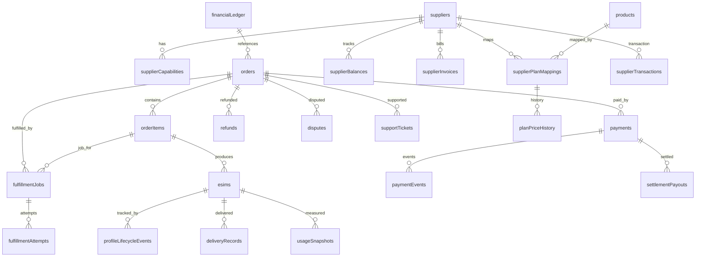

# ESIMPROVE — Supplier-Neutral eSIM Data Model Design

Design-only. No application files, migrations, DB contents, `.env.local`, or dependencies modified. Only new file created: `ESIMPROVE_ESIM_DATA_MODEL_DESIGN.md`. Confirmed by directory listing after write.

---

## 1. Repository Review (Evidence from Source)

- ORM: Drizzle (`drizzle-orm/pg-core`) — `lib/db/schema.ts` (885 lines)
- Migration framework: `lib/db/migrate.ts`; seeds in `seed.ts`
- Client pattern: `lib/db/client.ts`; getDb() async
- Authentication: `users`, `sessions` with `token_hash`, `pending_two_factor`, `totp_secret_encrypted` (`EncryptedSecret` type, line 13-21)
- Orders / items / payments / fulfillment: `orders`, `orderItems`, `payments`, `fulfillmentJobs`, `esims`, `supplierTransactions`, `orderEvents`
- eSIM secrets: `esims` has `lpa_ciphertext`, `lpa_iv`, `lpa_tag`, `dek_wrapped`, `dek_iv`, `dek_tag`, `key_version` — encrypted storage (line 288-315)
- Supplier/provider: `providers` (key, mode, isMock), `providerPlans`, `providerBalanceSnapshots`, `providerSyncJobs`
- Price history / availability: `planPriceHistory`, `planAvailabilitySnapshots`
- Refunds / invoices / audit / access logs / consent / preferences: `refunds`, `invoices`, `auditLogs`, `activationAccessLogs`, `userConsents`, `userPreferences`
- Webhooks / outbox: `webhookEvents`, `outboxEvents`
- Existing admin routes use `requireAdmin()`; actions in `app/admin/actions.ts`; security verified in Phase 6 audit.

**Distinction:** Existing items (e.g., `esims`, `orders`, `refunds`) are described below as-is. Proposed new entities (e.g., `supplierCapabilities`, `profileLifecycleEvents`, `deliveryEvidence`, `reconciliationRuns`, `disputes`, `privacyRequests`, `countryRestrictionRules`) are explicitly marked PROPOSED and do not exist in `lib/db/schema.ts` today.

---

## 2. Supplier-Neutral Entities (Design — Not Implemented)

All proposed. No migrations generated. `SUPPLIER-DEPENDENT` fields labeled where the supplier must document or verify.

### suppliers (PROPOSED)
- Purpose: Supplier identity, authorization status, capability metadata
- Fields: `id` (PK text), `key` (unique text), `name` text, `mode` (`sandbox`|`production`|`mock`), `isAuthorized` boolean, `capabilities` jsonb (`{ iccid: boolean, lpa: boolean, qr: boolean, profileLifecycle: boolean, topUp: boolean, renewal: boolean, webhook: boolean, cancellation: boolean, invoiceAccess: boolean }` — SUPPLIER-DEPENDENT), `verifiedAt` timestamp, `createdAt`
- PK: `id`; unique: `key`
- Indexes: `key`, `isAuthorized`
- Sensitivity: Low (public name / key OK; capabilities metadata internal)
- Auth: Admin only for config; read-only for fulfillment
- Tests: create; unique key; capability update audit

### supplierCapabilities (PROPOSED — metadata table)
- Purpose: Per-capability verification status (documented/sandbox/production/unknown)
- Fields: `id`, `supplierKey` (FK suppliers.key), `capability` text (`iccid`, `lpa_format`, `qr_payload`, `profile_states`, `remaining_data`, `expiry`, `top_up`, `renewal`, `wallet`, `pricing_sync`, `invoice_access`), `verificationStatus` (`unknown`|`documented`|`sandbox_verified`|`production_verified`), `verifiedAt`, `verifiedBy` (actor), `notes` text
- PK: `id`; unique on (`supplierKey`, `capability`)
- Index: (`supplierKey`, `verificationStatus`)
- Sensitivity: Internal configuration; no secrets
- Auth: Admin only
- Tests: verify each capability status update; reject invalid status

### products (PROPOSED — supplier-agnostic catalog master)
- Purpose: Normalized product definition independent of supplier-specific IDs
- Fields: `id`, `slug` unique, `name`, `destinationId` (FK regions/destinations if needed), `dataMb`, `validityDays`, `currency`, `status` (`published`|`deprecated`|`unavailable`), `createdAt`
- PK: `id`; unique: `slug`
- Index: `status`, `destinationId`
- Sensitivity: Public catalog
- Tests: create; unique slug; status transition

### supplierPlanMappings (PROPOSED)
- Purpose: Link internal product/plan to supplier product IDs with price history
- Fields: `id`, `supplierKey`, `supplierProductId` (SUPPLIER-DEPENDENT — supplier defines), `internalPlanId` (FK products.id), `costMinor`, `currency`, `effectiveFrom`, `effectiveTo`, `source` (`manual`|`supplier_sync`), `verifiedStatus`
- PK: `id`; unique (`supplierKey`, `supplierProductId`)
- Index: (`supplierKey`, `internalPlanId`), (`effectiveFrom`, `effectiveTo`)
- Sensitivity: Internal pricing; cost data restricted
- Auth: Admin / pricing role
- Tests: mapping creation; duplicate supplier product; price change preserves historical cost

### orders (EXISTS — `lib/db/schema.ts` 164-193)
- Already has: `id`, `orderNumber` (unique), `email`, `customerName`, `country`, `userId` (nullable FK users), `status` (`pending_payment` default), `paymentStatus`, `fulfillmentStatus`, `subtotalMinor`, `taxMinor`, `totalMinor`, `currency`, `idempotencyKey` (unique), `termsVersion`, `isDemo`, `paidAt`, timestamps
- **Note:** `status` (order-level) vs `paymentStatus` vs `fulfillmentStatus` are separate; payment success does not imply fulfillment success.
- Indexes: `order_number_unique`, `idempotency_key_unique`, `email_idx`, `created_at_idx`

### orderItems (EXISTS — 195-218)
- Has `planId` (FK plans), `planName`, `quantity`, `unitPriceMinor`, `totalMinor`, `costMinor`, `supplierKey`, `supplierProductId`, `dataMb`, `validityDays`, `currency`
- **Important:** `costMinor` and `supplierKey`/`supplierProductId` preserved at purchase time — enables historical cost reconciliation even if supplier price changes.

### payments (EXISTS — 220-240)
- Has `provider`, `providerPaymentId`, `status`, `amountMinor`, `currency`, `checkoutUrl`, `createdAt`, `updatedAt`; unique on (`provider`, `providerPaymentId`)
- **Proposed extension (design only, no change):** add `settlementStatus`, `settlementAt`, `settlementReference`, `feeMinor` — for reconciliation (not implemented).

### refunds (EXISTS — 480-501)
- Has `orderId`, `paymentId` (nullable FK), `amountMinor`, `currency`, `reason`, `status` (`requested` default), `providerRefundId`, `idempotencyKey` (unique), timestamps
- **Proposed extension (design only):** `evidenceStatus` (complete/partial/missing), `profileEvidenceUsed`, `manualReviewReason`, `approvedBy`, `disputeId` (nullable FK disputes.id)

### fulfillmentJobs (EXISTS — 261-286)
- Has `orderId`, `orderItemId` (FK), `status`, `attempts`, `maxAttempts` (8), `nextAttemptAt`, `leaseUntil`, `lastError`, `idempotencyKey` (unique), timestamps; indexes on (`status`, `nextAttemptAt`) and (`orderItemId` unique) and (`idempotencyKey` unique)
- **State machine (see §4):** queued → processing → completed | failed | cancelled

### fulfillmentAttempts (PROPOSED — individual try records)
- Purpose: Per-attempt evidence for retries / failure diagnosis / audit
- Fields: `id`, `jobId` (FK fulfillmentJobs.id), `attemptNumber`, `startedAt`, `finishedAt`, `status`, `supplierRequestId` (SUPPLIER-DEPENDENT), `supplierResponseStatus`, `supplierResponsePayload` (jsonb, masked), `errorMessage` (text), `idempotencyKey`, `createdAt`
- PK: `id`; index: (`jobId`, `attemptNumber`)
- Auth: Admin / operations
- Tests: retry creates new attempt; concurrent lease prevented

### esims (EXISTS — 288-315)
- Existing fields: `id`, `orderItemId` (FK, unique), `supplierKey`, `supplierEsimId` (SUPPLIER-DEPENDENT), `iccid` (nullable), `lpaCiphertext` + iv + tag, `dekWrapped` + iv + tag, `keyVersion`, `status` (`ready_to_install` default), `activatedAt`, `expiresAt`, `createdAt`, `updatedAt`; unique on (`orderItemId`), (`iccid`)
- **Proposed extensions (design, no change):** `qrPayload` (encrypted/protected), `profileState` (see state machine), `dataUsedMb`, `dataRemainingMb`, `activationEvidence` (jsonb: delivery timestamp, email open, device info — SUPPLIER-DEPENDENT), `revokedAt`, `topUpHistory` (jsonb array)

### profileLifecycleEvents (PROPOSED — supplier-independent tracking)
- Purpose: Track profile state changes independently of supplier response format
- Fields: `id`, `esimId` (FK esims.id), `fromState`, `toState`, `actorType`, `actorId`, `evidenceType` (`supplier_webhook`|`supplier_poll`|`manual`|`user_action`), `evidenceReference`, `recordedAt`, `metadata` jsonb
- PK: `id`; index: (`esimId`, `recordedAt`)
- Auth: Admin / operations
- Tests: valid transitions; invalid rejected; evidence reference preserved

### deliveryRecords (PROPOSED — delivery evidence for disputes / refund eligibility)
- Purpose: Proof of delivery / activation / email delivery
- Fields: `id`, `esimId` (FK), `orderId` (FK), `deliveryType` (`email_sent`|`qr_presented`|`profile_activated`|`installation_confirmed`), `deliveredAt`, `evidenceReference` (provider ref or email event id), `verified` boolean, `metadata` jsonb
- PK: `id`; index: (`esimId`, `deliveredAt`)
- Auth: Admin / support; sensitive evidence masked by default

### usageSnapshots (PROPOSED — data usage / remaining data; SUPPLIER-DEPENDENT)
- Purpose: Periodic usage records if supplier exposes data
- Fields: `id`, `esimId` (FK), `dataUsedMb`, `dataRemainingMb`, `recordedAt`, `source` (`supplier_poll`|`supplier_webhook`|`manual`), `verifiedStatus`
- PK: `id`; index: (`esimId`, `recordedAt`)
- Note: Only populate if supplier provides usage data; not required for basic operation

### idempotencyRecords (PROPOSED — centralized idempotency beyond per-table keys)
- Purpose: Prevent duplicate supplier orders / refunds / webhooks / emails across all external systems
- Fields: `id`, `key` (unique text, e.g., `supplier:{key}:order:{orderId}` or `wallet:{key}`), `entityType`, `entityId`, `createdAt`, `expiatesAt`
- PK: `id`; unique: `key`
- Auth: Internal (service-level); not user-facing
- Tests: duplicate key rejected; expiration respected

### financialLedger (PROPOSED — append-only; corrections via reversal entries)
- Purpose: Immutable financial history for orders / refunds / supplier costs / payouts
- Fields: `id`, `entryType` (`revenue`|`cost`|`refund`|`fee`|`reversal`), `orderItemId` (nullable FK), `supplierKey`, `amountMinor` (signed; negative for reversal), `currency`, `description`, `referenceId` (link to refund/payment/payout), `recordedAt`, `recordedBy`
- PK: `id`; index: (`orderItemId`, `recordedAt`), (`supplierKey`, `recordedAt`)
- Auth: Finance / admin only
- Tests: append only; reversal links to original; sum balances correctly

### supplierBalances (PROPOSED)
- Purpose: Track supplier wallet / balance for sales pausing
- Fields: `id`, `supplierKey`, `balanceMinor`, `currency`, `capturedAt`, `source` (`supplier_api`|`manual`|`reconciliation`)
- PK: `id`; index: (`supplierKey`, `capturedAt`)
- Note: Existing `providerBalanceSnapshots` is similar but supplier-neutral design should use `supplierKey`

### supplierInvoices (PROPOSED — supplier billing / cost verification)
- Purpose: Supplier invoice records for reconciliation
- Fields: `id`, `supplierKey`, `invoiceNumber` (unique per supplier), `amountMinor`, `currency`, `status` (`pending`|`approved`|`disputed`|`paid`), `issuedAt`, `dueAt`, `referencePeriodFrom`, `referencePeriodTo`, `items` jsonb (array of `{ supplierProductId, quantity, costMinor }`)
- PK: `id`; unique: (`supplierKey`, `invoiceNumber`)
- Auth: Finance / admin
- Tests: duplicate invoice number rejected; period overlap detected

### settlementPayouts (PROPOSED — payment provider payouts)
- Purpose: Track when payment provider transfers funds
- Fields: `id`, `provider`, `settlementReference`, `amountMinor`, `currency`, `feeMinor`, `netMinor`, `settledAt`, `status`
- PK: `id`; index: (`provider`, `settledAt`)
- Auth: Finance
- Tests: correct net = gross - fee; reconciliation sum matches

### reconciliationRuns (PROPOSED)
- Purpose: Periodic reconciliation of payments + supplier invoices + payouts
- Fields: `id`, `runType` (`daily`|`manual`), `startedAt`, `finishedAt`, `status`, `discrepancyCount`, `details` jsonb, `runBy`
- PK: `id`; index: (`startedAt`)
- Auth: Admin / finance
- Tests: discrepancy flagged; run idempotent

### reconciliationDiscrepancies (PROPOSED)
- Fields: `id`, `runId` (FK), `category` (`payment_vs_order`|`supplier_cost_vs_invoice`|`payout_vs_payment`), `referenceIds` jsonb, `expectedAmountMinor`, `actualAmountMinor`, `resolution` (`open`|`corrected`|`investigating`)
- PK: `id`
- Auth: Finance / admin

### disputes (PROPOSED)
- Purpose: Chargeback / dispute / refund dispute tracking
- Fields: `id`, `orderId` (FK), `refundId` (nullable FK), `reason` text, `deadlineAt`, `status` (`open`|`responding`|`resolved`|`lost`), `providerReference`, `evidenceStatus`, `evidenceIds` jsonb (refs to deliveryEvidence), `createdAt`, `resolvedAt`
- PK: `id`; index: (`orderId`, `deadlineAt`), (`status`, `deadlineAt`)
- Auth: Admin / support / finance
- Tests: deadline tracking; evidence collection; resolution requires evidence

### deliveryEvidence (PROPOSED — links to dispute / refund eligibility)
- Purpose: Central evidence store (email delivery, profile activation, installation confirmation)
- Fields: `id`, `esimId`, `deliveryRecordId`, `evidenceType`, `providerReference`, `capturedAt`, `verified`
- PK: `id`
- Auth: Admin / support (masked by default)

### adminAuditEvents (EXISTS — `auditLogs`; 402-415) — extended design
- Keep existing. Proposed addition: `sensitiveDataAccess` boolean, `activationAccess` boolean.

### sensitiveDataAccessLogs (EXISTS — `activationAccessLogs`; 417-433)
- Already exists with `esimId`, `actorType`, `actorId`, `ipHash`, `createdAt`. **Design confirms keep; extend to include `actionDetail` (view/Qr/code/activation data) and `maskApplied` boolean.**

### privacyRequests (PROPOSED)
- Fields: `id`, `userId` (FK), `requestType` (`export`|`delete`|`correct`|`restrict`), `status`, `requestedAt`, `completedAt`, `exemptions` jsonb (retention-required records), `recordedBy`
- PK: `id`
- Auth: Admin / privacy office; user can view own
- Tests: retention exceptions preserved; deletion does not remove required audit/ledger

### consentRecords (EXISTS — `userConsents`; 567-589) — design confirms keep
- `purpose`, `version`, `accepted`, `ipHash`, `userAgent`
- Unique on (`userId`, `purpose`, `version`)

### countryRestrictionRules (PROPOSED)
- Fields: `id`, `countryCode` (unique), `status` (`allowed`|`blocked`|`restricted`), `reason`, `effectiveFrom`, `effectiveTo`, `updatedAt`
- PK: `id`; unique: `countryCode`
- Auth: Admin / legal
- Tests: country block enforced at checkout; restriction changes audit-logged

### webhookEvents (EXISTS — 242-259) — design confirms keep; extend
- Add proposed `processingStatus` (pending/processed/failed/retry), `retryCount`, `nextRetryAt`

### systemAlerts (PROPOSED — from monitoring rules in admin)
- Purpose: Operational alert records (supplier balance, fulfillment failure, webhook failure)
- Fields: `id`, `ruleName`, `severity`, `message`, `metadata` jsonb, `triggeredAt`, `acknowledgedAt`, `acknowledgedBy`
- PK: `id`; index: (`severity`, `triggeredAt`)
- Auth: Admin / ops
- Tests: alert creation; acknowledgment; duplicate suppression

### orderNotes / internalNotes (PROPOSED — support/internal)
- Fields: `id`, `orderId` (FK), `noteType` (`internal`|`customer_visible`), `body`, `authorType`, `authorId`, `createdAt`
- PK: `id`; index: `orderId`

### supportTickets / messages (EXISTS — 503-531) — confirmed

---

## 3. Supplier-Dependent Fields / Capabilities (Verified / Unknown)

Every item labeled with verification status; no assumption made.

| Capability / Field | Status | Evidence / Note |
|---|---|---|
| ICCID available from supplier | `unknown` | Schema has `iccid` (nullable) on `esims`; supplier may not expose |
| Activation code (LPA) format | `documented` | `esims` stores encrypted LPA; format depends on supplier (SUPPLIER-DEPENDENT) |
| QR payload format | `unknown` | Not shown in schema; supplier may provide or may not |
| Profile lifecycle states | `unknown` | `esims.status` exists (`ready_to_install` default); more states (downloaded/installed/enabled/expired/revoked) are SUPPLIER-DEPENDENT |
| Remaining data / expiry | `unknown` | `expiresAt` exists; real-time remaining data requires supplier API — SUPPLIER-DEPENDENT |
| Top-ups / renewals | `unknown` | No table; depends on supplier |
| Supplier wallet / balance | `documented` (mock) | `providerBalanceSnapshots`; `provider` table `mode=sandbox`; live verification BLOCKED |
| Supplier webhooks | `documented` (mock) | `webhookEvents`; `providerSyncJobs`; live delivery not verified |
| Cancellation / refund capabilities | `partially_documented` | `refunds` table exists; supplier may impose constraints — SUPPLIER-DEPENDENT |
| Supplier invoice / pricing updates | `unknown` | `planPriceHistory`; `supplierTransactions` (client-side log); supplier invoice access not verified |
| Device compatibility | `unknown` | No table / schema reference |

---

## 4. State Machines (Design — Not Implemented)

Only valid transitions defined; invalid transitions rejected at application layer.

**Payment:** `pending` → `processing` → `completed` | `failed` → (`retry_eligible` → `processing` after retry) → `completed`. `completed` is terminal; refund requires separate refund workflow. **Rule:** payment `completed` never implies fulfillment or profile activation.

**Fulfillment:** `queued` → `processing` (leased) → `completed` | `failed` (≤ maxAttempts) → `cancelled`. Retry: new `fulfillmentAttempts`; `nextAttemptAt` computed with backoff (not fixed).

**Delivery:** `not_started` → `email_sent` → `qr_presented` → `profile_activated`. Each step requires evidence (`deliveryRecords`). Manual steps allowed with audit.

**eSIM Profile Lifecycle:** `ready_to_install` → `downloaded` → `installed` → `enabled` → `expired` (time) / `revoked` (manual / supplier / dispute). Transitions to `revoked`/`expired` are terminal for sales; refund eligibility depends on evidence at time of request (not automatic rejection at `enabled`).

**Refund:** `requested` → `under_review` → `approved` / `rejected` / `pending_evidence`. Evidence required before approval if profile shows `enabled` or `installed`; manual review required when evidence incomplete.

**Dispute:** `open` → `responding` → `resolved` (won/lost/settled) | `escalated`. Deadline (`deadlineAt`) drives response timeline.

**Reconciliation:** `pending` → `running` → `completed` | `discrepancy_found`. Discrepancy requires manual resolution.

---

## 5. Idempotency & Financial Integrity (Design Rules)

- Supplier orders: `supplierTransactions` has unique (`supplierKey`, `clientTransactionId`) — prevents duplicate supplier orders.
- Refunds: `refunds.idempotencyKey` unique — prevents duplicate refund requests.
- Webhooks: `webhookEvents` unique (`provider`, `externalEventId`) — prevents double processing.
- Email: `emailEvents` with `template` + `recipient`; duplicate prevention via idempotency key (proposed).
- Concurrent requests: lease mechanism (`fulfillmentJobs.leaseUntil`) + DB-level unique constraints prevent duplicate fulfillment attempts.
- Timeout with uncertain supplier result: treat as `unknown`; do not auto-confirm fulfillment or profile activation; require supplier confirmation or manual review.
- Retry exhaustion (`maxAttempts` reached): move to `failed`; alert; manual review required.
- Ledger: append-only; correction via `reversal` entry referencing original `referenceId`. No in-place updates to historical amounts.
- Historical cost preservation: `orderItems.costMinor` preserved at purchase; `planPriceHistory` tracks supplier price changes; `financialLedger` records cost and revenue separately.

---

## 6. Refund Eligibility & Disputes (Design Rules)

- Configurable decision model based on: payment status, fulfillment status, delivery evidence (`deliveryRecords`), profile state (`esims` + `profileLifecycleEvents`), supplier constraints (documented or unknown), consumer-protection rules (jurisdiction-dependent — requires qualified review), evidence completeness.
- **Not automatic rejection** when profile installed/enabled: evidence evaluated; manual review if evidence incomplete or supplier allows partial refund.
- Evidence gaps: missing delivery evidence → `pending_evidence`; not automatic reject; request evidence from supplier/user.
- Dispute table (`disputes`) captures deadlines, provider references, evidence ids (`evidenceIds` jsonb), resolution.

---

## 7. Security & Privacy (Design Rules)

- Activation secrets: `esims` fields `lpaCiphertext`/`dekWrapped` encrypted; access via `activationAccessLogs`; masked by default in all queries; never returned in admin listings.
- QR / activation data: protected similarly; access requires admin + audit; no bulk export without authorization.
- Role restrictions: admin only for supplier config / pricing / audit / activation access; support for tickets only; customer for own data.
- Retention: audit/logs retained per legal requirements; privacy requests (`privacyRequests`) handle deletion with exemptions; deletion does not remove `auditLogs`, `financialLedger`, `activationAccessLogs` if legally required.
- Export / deletion workflows: `privacyRequests` tracks status; `consentRecords` preserved; `userPreferences` / `userConsents` retained for consent evidence.
- No secrets in this document; no customer data included.

---

## 8. Required Test Matrix (Per Proposed Entity / Transition)

Tests requiring named supplier or sandbox explicitly noted.

| Scenario | Required | Supplier / Sandbox Needed |
|---|---|---|
| Supplier create / unique key | Unit / auth | No |
| Capability verification update | Unit / auth | No (status update only) |
| Supplier capability `unknown` handled safely | Integration | Yes (documented supplier) |
| Product + supplierPlanMapping create; duplicate supplier product rejected | Unit | No |
| Price history preserves historical cost at order time | Integration | No |
| Order + item create; fulfillment job queued; retry creates new attempt | Integration | No |
| Payment completed but fulfillment failed | Integration | No |
| Unknown supplier result after timeout | Integration | Yes (sandbox timeout simulate) |
| Profile lifecycle valid/invalid transitions | Unit | No |
| Profile enabled → refund requested with evidence complete | Integration | Maybe (supplier supports) |
| Profile enabled → refund with incomplete evidence | Integration | No |
| Duplicate supplier order (idempotency) | Integration | No |
| Duplicate refund (idempotency) | Integration | No |
| Duplicate webhook (idempotency) | Integration | No |
| Concurrent fulfillment lease prevented | Integration | No |
| Unauthorized activation data access blocked / masked | Auth / integration | No |
| Audit log for activation access | Integration | No |
| Financial ledger append-only; reversal links original | Integration | No |
| Supplier invoice / payout mismatch flagged | Integration | Yes (supplier invoice feed) |
| Reconciliation discrepancy resolution | Integration | Yes |
| Privacy request with retention exception preserved | Integration | No |
| Country restriction block at checkout | Integration | No |
| Webhook delivery failure / retry / alert | Integration | Yes (webhook endpoint) |

---

## 9. Mermaid Diagrams

### Entity Relationships (Simplified)

---

## 10. Phased Implementation Plan (Proposed — Not Executed)

1. **Phase 1 — Supplier capability + mapping:** `suppliers`, `supplierCapabilities`, `supplierPlanMappings`, extend `plans` linkage. Requires supplier documentation for capability verification status.
2. **Phase 2 — Fulfillment + delivery evidence:** `fulfillmentAttempts`, `deliveryRecords`, extend `esims` with profile states, `profileLifecycleEvents`.
3. **Phase 3 — Financial integrity:** `financialLedger`, `reconciliationRuns`/`discrepancies`, `settlementPayouts`.
4. **Phase 4 — Refund + dispute + privacy:** extend `refunds`, add `disputes`, `deliveryEvidence`, `privacyRequests`, extend audit/access logs.
5. **Phase 5 — Operations + compliance:** system alerts, country rules, consent/retention verification.

---

## 11. Open Questions Requiring Supplier Decision

- ICCID format / availability: `unknown`
- LPA / QR payload format: `documented` but must confirm per supplier
- Profile lifecycle states supported (downloaded/installed/enabled): `unknown`
- Remaining data / expiry API availability: `unknown`
- Top-up / renewal support: `unknown`
- Cancellation / refund policy constraints (installed profiles): `partially_documented`
- Invoice / cost-sync format and frequency: `unknown`
- Webhook event types and retry behavior: `documented` (mock)
- Device compatibility data source: `unknown`
- Sandbox endpoint availability and test credentials: BLOCKED by external prerequisites

---

## 12. Confirmation (No Changes Made)

- New file only: `ESIMPROVE_ESIM_DATA_MODEL_DESIGN.md`
- No modifications to `lib/db/schema.ts`, `lib/db/migrate.ts`, `lib/config.ts`, `proxy.ts`, `app/admin/actions.ts`, `.env.local`, `package.json`, or any other existing file
- No migrations generated; no `CREATE TABLE` executed; no DB connection modifications
- Design references existing schema (lines 1-885 of `lib/db/schema.ts`) accurately; all proposed entities clearly marked PROPOSED
- Next 3 decisions needed: supplier capability documentation, sandbox verification plan, profile lifecycle confirmation
