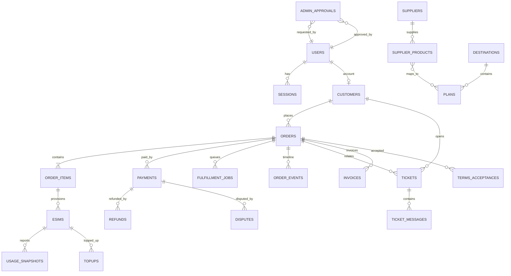

# Data model draft

**Status:** Target design plus a working local demo schema. **No managed PostgreSQL database or production migration has been tested.**
**Database:** PostgreSQL. All timestamps are UTC (`timestamptz`). Money is integer minor units plus ISO-4217 currency code. Never use floats for money.

> **Current implementation:** `lib/db/schema.ts` and `db/migrations/0001_initial.sql` are authoritative
> for the local demo. This document is the longer-term target and includes entities that are **not**
> implemented (refunds, disputes, customers, roles, suppliers, usage, tickets, consent, etc.).
> Where this document and the schema differ, the schema wins.

## 0. Implemented demo schema

Tables currently created by the migration:

| Table | Purpose / notable fields |
|---|---|
| `users` | Demo/customer accounts; `role`, scrypt `password_hash`, `email_verified_at`, `totp_enabled`, encrypted `totp_secret_encrypted` |
| `sessions` | Hashed opaque session tokens, `pending_two_factor`, IP hash, user agent, expiry |
| `regions` | Demo region catalogue |
| `destinations` | Demo country catalogue with region FK and `popular` |
| `plans` | Demo plans with cost/price/markup/tax, supplier key/product ID, coverage/network text, `status`, `is_demo` |
| `carts` / `cart_items` | Cookie-token cart; one row per plan per cart; captured unit price/currency |
| `orders` | Guest/customer order with payment/fulfillment status, money snapshot, unique order number and idempotency key, `is_demo` |
| `order_items` | Immutable-ish plan/price/cost/supplier snapshot per line |
| `payments` | Mock provider checkout record, amount/currency, status, checkout URL |
| `webhook_events` | Provider event dedupe key and payload hash |
| `fulfillment_jobs` | Per-order-item job, attempts/max attempts, lease, backoff, idempotency key |
| `esims` | Encrypted LPA envelope, ICCID, supplier IDs, status, expiry |
| `supplier_transactions` | Mock supplier order record and raw payload |
| `order_events` | Customer-visible order timeline |
| `order_access_tokens` | Hashed guest order access tokens with expiry/revocation |
| `email_events` | Mock email log with redacted body |
| `outbox_events` | Transactional outbox |
| `audit_logs` | Security/admin/system audit trail |
| `activation_access_logs` | Every activation view (actor, IP hash) |
| `rate_limit_counters` | Fixed-window rate limits |

Important differences from the target design below:

- There is no separate `customers`, `roles`, `permissions`, `suppliers`, `supplier_products`,
  `refunds`, `disputes`, `usage_snapshots`, `topups`, `tickets`, `consent_records`, or
  `legal_documents` table in the demo.
- `users.role` is a simple text role (`customer`/`admin`), not RBAC.
- Payment status is `pending`/`authorized`/`paid`/`failed`/`refunded`; refunds/disputes are not
  implemented.
- Fulfillment status includes `ready` and `under_investigation`; the worker sets
  `delivered`/`failed`/`queued`/`provisioning`.
- The demo does not use optimistic `version` columns, soft deletes, or restricted database roles.
- Activation encryption columns are named `lpa_ciphertext`, `lpa_iv`, `lpa_tag`, `dek_wrapped`,
  `dek_iv`, `dek_tag`, `key_version`.
- `is_demo` flags exist on orders and plans; seeded catalogue rows are all demo.

---

## 1. Conventions

- Primary keys: UUIDv7/ULID generated by the application, `NOT NULL`.
- Public references: human-readable prefixes (`ORD-`, `TKT-`, `INV-`) are separate unique columns, not primary keys.
- Soft deletion is avoided for financial records; use status/`voided_at` and immutable history.
- Every mutable financial/security record has `version INTEGER NOT NULL DEFAULT 1` for optimistic locking.
- Append-only tables have no `UPDATE`/`DELETE` grants for the application role; tests should prove this using a restricted role where possible.
- `created_at`, `updated_at` are `timestamptz NOT NULL DEFAULT now()`; UI displays local time.
- All foreign keys have explicit `ON DELETE RESTRICT` or `ON DELETE SET NULL`; no cascading deletes across financial records.
- JSONB is for snapshots/raw provider payloads, never the sole source of an important business field.
- Sensitive activation material is stored only as ciphertext + IV + auth tag + key version.
- Email addresses are normalised to lowercase for uniqueness; display original case separately if needed.
- IP addresses are stored as salted hashes for rate/fraud/audit use unless a specific legal basis requires the raw value.
- No raw card data is ever stored.
- Unique constraints are the final defence for idempotency, not just application checks.

---

## 2. High-level relationship map

A plan may map to one supplier product for MVP; the join table (`supplier_product_mappings`) will support multiple suppliers later.

---

## 3. Identity, access, and privacy

### `users`
Application identities (customers and staff).

Key columns: `id`, `email` (unique, lowercased), `email_verified_at`, `name`, `password_hash` (nullable if future passwordless), `role_id`, `locale`, `preferred_currency`, `disabled_at`, `last_login_at`, `version`, timestamps.

Constraints/indexes:
- Unique lower(email).
- Cannot delete a user with orders/audit references; anonymise instead.
- Role is authoritative server-side; avoid trusting client claims.

### `roles`, `permissions`, `role_permissions`, `user_roles`
Least-privilege model. Seed roles: `customer`, `support`, `finance`, `ops`, `admin`, `owner`. A user may have multiple staff roles; customer is default. Admin/owner roles require 2FA.

### `sessions`
Custom DB-backed sessions in the demo; a production auth library may replace this.
Key columns: `id`, `user_id`, `token_hash` (unique), `expires_at`, `last_seen_at`, `ip_hash`, `user_agent_hash`, `created_at`, `revoked_at`, `revoke_reason`.

### `two_factor` (target)
Encrypted TOTP secret, backup-code hashes, enabled timestamp, trusted-device records if enabled.
Never log the TOTP secret. The demo stores the encrypted TOTP secret on `users` instead of a
separate table and does not implement backup codes.

### `email_verification_tokens`, `password_reset_tokens`, `guest_access_tokens`
Store token hashes, purpose, user/order link, `expires_at`, `used_at`, `created_at`, request IP hash. Single-use.

### `customers`
Commercial customer record, linkable to one user.
Key columns: `id`, `user_id` (nullable unique), `email`, `display_name`, `billing_country`, `created_at`, `anonymised_at`.
Guest checkout creates a customer record without a user; claiming it later requires verified email and an explicit merge process. Multiple emails should not silently merge.

### `consent_records`
`id`, `customer_id`/`user_id`, `consent_type` (marketing, analytics, terms), `policy_version`, `granted` boolean, `source`, `ip_hash`, `created_at`. Append-only.

### `terms_acceptances`
`id`, `order_id`, `user_id`/`customer_id`, `terms_version`, `refund_policy_version`, `privacy_version`, `accepted_at`, `ip_hash`, `user_agent_hash`, `checkout_snapshot_hash`. Immutable.

### `privacy_requests`
`id`, `customer_id`, `type` (`export`,`delete`,`rectify`), `status`, `requested_at`, `due_at`, `completed_at`, `notes_internal`, `evidence_ref`. Deletion is a controlled anonymisation workflow, not a naive row delete.

### `communication_preferences`
`id`, `customer_id` unique, `marketing_email_consent`, `unsubscribe_token_hash`, `updated_at`.

---

## 4. Catalogue and supplier entities

### `regions`
`id`, `slug` unique, `name`, `type` (`continent`,`multi_country`,`global`), `parent_id`, `published`, `content_json`, SEO fields.

### `destinations`
`id`, `slug` unique, `name`, `country_code` (ISO 3166-1 alpha-2 when applicable), `destination_type` (`country`,`territory`,`region`,`global`), `region_id`, `published`, `summary`, `content_json`, SEO title/description, `content_reviewed_at`, `source_provenance_json`.
No destination is published unless supplier coverage exists. Content claims require provenance.

### `coverage_areas`
`id`, `supplier_product_id`, `destination_id`, `network_names_json`, `network_generations_json` (only verified values), `coverage_notes`. Distinct from marketing content.

### `suppliers`
`id`, `key` unique (`esim_access`, `esim_go`, `fixture`), `display_name`, `environment` (`test`,`live`), `enabled`, `live_orders_enabled` default false, `config_json` (non-secret), `last_health_at`, `health_status`, timestamps.

### `secret_references`
`id`, `supplier_id`/`provider`, `name`, `secret_store_ref`, `key_version`, `rotated_at`, `created_by`. No plaintext secret values in the DB.

### `supplier_products`
`id`, `supplier_id`, `external_id`, `slug`, `name`, `raw_payload` JSONB, `payload_hash`, `cost_raw` BIGINT, `cost_scale` INTEGER, `cost_currency`, `data_bytes` BIGINT nullable, `is_unlimited` boolean, `fup_notes`, `validity_days`, `validity_starts` (install/activation/first connection, from supplier terms), `supports_topup` boolean, `supports_hotspot` boolean nullable (unknown if not verified), `calls_sms` nullable, `network_generation` nullable, `coverage_json`, `last_seen_at`, `active`, timestamps.
- Unique `(supplier_id, external_id)`.
- Do not infer missing booleans; use NULL for unknown and hide the claim.
- Store raw supplier values for reconciliation, but never render them directly.

### `plans`
Normalised sellable plan for MVP.
`id`, `slug` unique, `destination_id`/`region_id`, `name`, `description`, `data_bytes`, `is_unlimited`, `fair_use_notes`, `validity_days`, `validity_starts`, `supports_hotspot`, `calls_sms`, `network_generation`, `status` (`draft`,`pending_review`,`active`,`paused`,`retired`), `published_at`, SEO fields, `default_supplier_product_id` (nullable), timestamps.
- `unlimited` plans must display the supplier's fair-use/network-management terms, not just “unlimited”.
- Plan facts come from supplier-provenance fields; marketing copy is separately reviewed.

### `supplier_product_mappings`
`id`, `plan_id`, `supplier_product_id`, `priority`, `active`, `cost_currency`, `cost_raw`, `cost_scale`, `last_synced_at`. Unique `(plan_id, supplier_product_id)`. Enables Version 2 multi-supplier.

### `pricing_rules`
`id`, `scope` (`global`,`supplier`,`destination`,`plan`), `supplier_id`/`destination_id`/`plan_id` nullable, `percentage_markup_bps`, `fixed_markup_minor`, `min_margin_minor`, `min_sell_minor`, `currency`, `priority`, `effective_from`, `effective_to`, `active`, `version`, `created_by`, `approved_by`.
- Effective-dated; no edits to historic rule rows; create a new version.
- Significant changes require approval.

### `price_history`
Append-only: `id`, `plan_id`, `supplier_product_id`, `cost_raw`, `cost_scale`, `cost_currency`, `fx_rate_nano`, `sell_minor`, `sell_currency`, `margin_minor`, `source` (`sync`,`manual`,`promotion`), `review_status`, `created_at`, `created_by`, `approved_by`.
- Unique change fingerprint/index for detecting duplicate syncs.
- Supplier price changes above threshold enter `pending_review`.

### `currencies`
`code` PK, `name`, `symbol`, `minor_unit` (decimals), `active`, `rounding_mode`, `display_order`.

### `fx_rates`
Append-only: `id`, `base_currency`, `quote_currency`, `rate_nano` BIGINT (1e9), `source`, `fetched_at`, `valid_from`, `valid_until`, `active`. Unique tuple. Orders store a copy of the exact rate/time.

---

## 5. Cart and checkout

### `carts`
`id`, `user_id` nullable, `anon_token_hash` nullable, `currency`, `status` (`open`,`converted`,`abandoned`,`expired`), `expires_at`, `version`.

### `cart_items`
`id`, `cart_id`, `plan_id`, `quantity` (check >=1 and <= cap), `unit_price_minor`, `currency`, `price_snapshot_hash`, `created_at`. Unique `(cart_id, plan_id)` optionally.
- Prices are snapshots for display; checkout always revalidates.

### `checkout_intents`
`id`, `cart_id`, `customer_id`, `email`, `currency`, `amount_minor`, `tax_minor`, `discount_minor`, `price_snapshot_hash`, `terms_version`, `status`, `idempotency_key` unique, `created_at`, `expires_at`.
- Used to make double-submits safe and record exactly what the customer saw.

### `orders`
`id`, `order_number` unique, `customer_id`, `user_id` nullable, `email_normalized`, `currency`, `charge_currency`, `fx_rate_nano`, `subtotal_minor`, `discount_minor`, `tax_minor`, `fee_minor`, `total_minor`, `amount_paid_minor`, `refunded_minor`, `payment_status`, `fulfillment_status`, `risk_status`, `country`, `terms_version`, `privacy_version`, `checkout_snapshot_hash`, `correlation_id`, `version`, timestamps.
- Check totals non-negative.
- Do not overwrite price components after creation; use append-only adjustments/refunds.
- Unique idempotency key may live in `checkout_intents` or `order_idempotency`.
- `email_normalized` is for lookup only; no public listing by email.

### `order_idempotency`
`id`, `idempotency_key` unique, `order_id`, `request_hash`, `created_at`. Prevents duplicate order creation from client retries or multiple tabs.

### `order_items`
`id`, `order_id`, `plan_id`, `supplier_product_id`, `quantity`, `unit_price_minor`, `unit_cost_raw`, `unit_cost_scale`, `unit_cost_minor`, `cost_currency`, `fx_rate_nano`, `tax_minor`, `discount_minor`, `total_minor`, `plan_snapshot` JSONB, `terms_snapshot` JSONB, `supplier_reference`.
- Snapshot includes plan data, validity trigger, coverage, hotspot/calls, refund terms, and source.
- Unique `(order_id, line_number)`.
- Cost/sale/FX/tax remain separate.

### `order_events`
Append-only order timeline: `id`, `order_id`, `event_type`, `actor_type`, `actor_id`, `source`, `data_redacted` JSONB, `correlation_id`, `created_at`. No activation data.

---

## 6. Payments, refunds, disputes, finance

### `payments`
`id`, `order_id`, `provider`, `provider_payment_id` unique, `provider_checkout_id`, `amount_minor`, `currency`, `charge_currency`, `method`, `status` (`pending`,`authorized`,`paid`,`failed`,`partially_refunded`,`refunded`,`disputed`), `fee_minor`, `captured_at`, `failed_reason_code`, `raw_event_version`, `version`, timestamps.
- Unique `(provider, provider_payment_id)`.
- Never store card data; only provider references and safe display metadata (brand/last4 if provider returns and policy allows).

### `payment_events`
Append-only provider event projection: `id`, `payment_id`, `event_type`, `provider_event_id`, `event_created_at`, `amount_minor`, `currency`, `payload_hash`, `received_at`, `processed_at`. Unique provider event ID.

### `refunds`
`id`, `order_id`, `payment_id`, `provider_refund_id` unique nullable, `amount_minor`, `currency`, `reason_code`, `reason_note_internal`, `status` (`requested`,`pending_approval`,`approved`,`processing`,`succeeded`,`failed`,`cancelled`), `requested_by`, `approved_by`, `approved_at`, `processed_at`, `failure_code`, `idempotency_key` unique, timestamps.
- Four-eyes check: approver ≠ requester for over-threshold or all refunds (owner decision).
- Refund amount cannot exceed captured minus already refunded.

### `payment_disputes`
`id`, `payment_id`, `provider_dispute_id` unique, `amount_minor`, `currency`, `status`, `reason`, `evidence_due_at`, `evidence_json_redacted`, `outcome`, `closed_at`. Evidence can include order/payment refs, consent timestamps, fulfillment status, support history, but not unnecessary PII.

### `invoices`
`id`, `order_id` unique, `invoice_number` unique, `seller_snapshot` JSONB (verified legal details only), `buyer_snapshot` JSONB, `tax_breakdown` JSONB, `currency`, `total_minor`, `storage_key` nullable, `issued_at`, `voided_at`.

### `tax_records`
`id`, `order_id`, `country`, `tax_type`, `rate_bps`, `taxable_minor`, `tax_minor`, `currency`, `tax_id`, `basis`, `created_at`. Append-only. Empty/zero tax must have a documented basis until tax advice exists.

### `supplier_transactions`
`id`, `supplier_id`, `order_id`, `fulfillment_job_id`, `type` (`create_order`,`query_order`,`query_esims`,`cancel`,`topup`,`usage`,`refund_credit`), `client_transaction_id`, `supplier_order_ref`, `supplier_esim_ref`, `request_hash`, `response_hash`, `status`, `error_code`, `created_at`.
- Unique `(supplier_id, client_transaction_id)` where applicable.
- Raw payload redacted; no LPA/access code.

### `refund_approval_thresholds` / settings
Stored in `settings` or config: threshold, currency, approver role.

---

## 7. eSIM and activation data

### `esims`
`id`, `order_item_id`, `supplier_id`, `supplier_esim_ref`, `iccid`, `imsi` nullable, `msisdn` nullable, `order_ref`, `status` (`awaiting_provisioning`,`ready_to_install`,`active_verified`,`expired`,`failed`,`cancelled`,`refunded`), `install_confirmation` (`none`,`customer_reported`), `supplier_smdp_status`, `supplier_esim_status`, `activated_at`, `expires_at`, `last_synced_at`, `reinstall_policy`, `version`, timestamps.
- One or more eSIMs per order item according to quantity.
- `active_verified` only from supplier evidence, never payment.
- Index unique on `(supplier_id, iccid)` when iccid present.
- Do not display `imsi`/`msisdn` unless needed and authorized; they are sensitive.

### `activation_data`
`id`, `esim_id` unique, `ciphertext` BYTEA, `iv` BYTEA, `auth_tag` BYTEA, `key_version` integer, `created_at`, `rotated_at`.
- LPA/activation code encrypted with AES-256-GCM.
- Never store plaintext. Decryption only in server-side authorized handlers.
- A separate delivery token table is used for links.

### `activation_access_logs`
Append-only: `id`, `esim_id`, `actor_type`, `actor_user_id`, `order_id`, `purpose` (`customer_view`,`delivery_link`,`support_view`,`rotation_job`), `ip_hash`, `user_agent_hash`, `correlation_id`, `created_at`. No LPA.

### `usage_snapshots`
`id`, `esim_id`, `used_bytes`, `total_bytes`, `remaining_bytes`, `expires_at`, `source`, `observed_at`, `supplier_updated_at`, `is_delayed` boolean, `created_at`.
- Display “as reported by carrier/supplier; may be delayed”.
- Never claim real-time when delay is documented.

### `topups`
`id`, `esim_id`, `order_id` nullable, `supplier_transaction_id`, `supplier_esim_ref`, `amount_minor`, `currency`, `status`, `provider_payment_id`, `idempotency_key` unique, `created_at`, timestamps.

### `esim_inactivity_events`
`id`, `esim_id`, `event_type` (`deletion_scheduled`,`deleted`,`suspended`), `supplier_event_id`, `payload_redacted`, `received_at`, `handled_at`. Needed for reinstall warnings and deletion scheduling.

---

## 8. Fulfillment and eventing

### `fulfillment_jobs`
`id`, `order_id`, `order_item_id`, `kind` (`provision`,`reconcile`,`email_delivery`,`usage_sync`,`expiry_notice`), `status` (`queued`,`claimed`,`processing`,`succeeded`,`failed`,`dead`,`cancelled`), `idempotency_key` unique, `attempts`, `max_attempts`, `next_attempt_at`, `locked_at`, `locked_by`, `last_error_code`, `last_error_redacted`, `created_at`, `updated_at`.
Indexes: `(status, next_attempt_at)`, `(order_id)`, `(idempotency_key)`.

### `outbox_events`
`id`, `aggregate_type`, `aggregate_id`, `event_type`, `event_key` unique, `payload_redacted` JSONB, `status` (`pending`,`processing`,`done`,`dead`), `available_at`, `attempts`, `last_error`, `created_at`, `processed_at`.
- Written in the same transaction as the business change.
- Payload references IDs; no secrets.

### `webhook_events`
`id`, `provider`, `external_event_id`, `event_type`, `payload_hash`, `payload_redacted` JSONB, `received_at`, `processing_at`, `processed_at`, `status` (`received`,`processed`,`ignored`,`failed`,`rejected`), `error_code`.
Unique `(provider, external_event_id)`. For supplier webhooks that lack signatures, use a random path token plus IP allowlist and dedupe; log a security warning.

### `email_events`
`id`, `template`, `recipient_hash`, `provider_message_id` unique nullable, `order_id`/`user_id`, `status` (`queued`,`sent`,`delivered`,`bounced`,`complained`,`failed`), `error_code`, `created_at`, `occurred_at`.
- Do not store full email body if it contains activation data.
- Delivery links are tokenised and expiry-controlled.

### `email_suppressions`
`id`, `email_hash` unique, `reason` (`hard_bounce`,`complaint`,`manual`,`unsubscribe`), `created_at`, `source`.

---

## 9. Support, content, marketing, and compliance

### `tickets`
`id`, `ticket_number` unique, `customer_id`, `order_id` nullable, `esim_id` nullable, `subject`, `category`, `priority`, `status`, `assigned_to`, `first_response_at`, `resolved_at`, `created_at`, `updated_at`.

### `ticket_messages`
`id`, `ticket_id`, `author_type` (`customer`,`staff`,`system`), `author_id`, `body`, `is_internal`, `created_at`.
Internal notes are excluded from customer queries at both query and serialization layers.

### `ticket_attachments`
`id`, `ticket_id`, `message_id`, `storage_key` unique, `original_name`, `content_type`, `size_bytes`, `sha256`, `scan_status` (`pending`,`clean`,`infected`,`unavailable`), `uploaded_by`, `created_at`. Downloads require authorization and signed short-lived URLs. Attachments disabled until scanning is available.

### `coupons` / `promotions`
`coupons`: `code` unique, `type`, `value`, `currency`, `min_order_minor`, `max_redemptions`, `per_customer_limit`, `starts_at`, `ends_at`, `active`, `version`.
`coupon_redemptions`: `coupon_id`, `order_id` unique, `customer_id`, `amount_minor`, `created_at`. Unique prevents double use.

### `reviews`
`id`, `order_item_id` unique, `customer_id`, `rating`, `body`, `status`, `verified_purchase`, `moderation_notes`, `published_at`. Empty by default. Never seed fake reviews.

### `newsletter_subscribers`
`id`, `email_hash`/encrypted email, `consent_version`, `consent_at`, `source`, `unsubscribed_at`. Marketing only with consent and unsubscribe.

### `policy_versions`
`id`, `policy_key` (`terms`,`privacy`,`refunds`,`cookies`,`digital_delivery`), `version`, `content_hash`, `published_at`, `review_status` (`draft`,`legal_review`,`approved`), `approved_by`, `effective_at`.

### `legal_entity_settings`
Key/value or typed table: legal name, address, registration number, tax ID, support addresses, jurisdiction, controller details. Defaults empty; UI must show “company details pending” and launch must be blocked.

### `restricted_destinations` / `market_rules`
`id`, `country_code`, `rule_type` (`no_sell`,`review_required`,`warning`), `reason`, `effective_from`, `effective_to`, `created_by`. Used at catalogue and checkout.

### `feature_flags`
`key` unique, `enabled`, `description`, `updated_by`, `updated_at`. Server-side only for security-sensitive flags.

### `settings`
`key` unique, `value_json`, `version`, `updated_by`, `updated_at`. No plaintext secrets. Includes incident banner, thresholds, support hours (must be verified).

### `incidents` / `site_banners`
`id`, `severity`, `status`, `message`, `starts_at`, `ends_at`, `created_by`, `resolved_at`. Public banner only when intentionally published.

### `admin_approvals`
`id`, `action_type`, `entity_type`, `entity_id`, `requested_by`, `request_payload_hash`, `status` (`pending`,`approved`,`rejected`,`expired`,`executed`), `approved_by`, `approved_at`, `expires_at`, `executed_at`, `reason`.
- Check `approved_by <> requested_by` in application and DB trigger/constraint where possible.
- Every execution is idempotent.

### `audit_logs`
Append-only: `id`, `actor_type`, `actor_user_id`, `action`, `entity_type`, `entity_id`, `before_redacted` JSONB, `after_redacted` JSONB, `ip_hash`, `correlation_id`, `created_at`.
- No activation data, secrets, or raw payment details.
- Restricted DB role: `INSERT` only.

### `alerts`
`id`, `severity`, `source`, `code`, `title`, `detail_redacted`, `status` (`open`,`acknowledged`,`resolved`), `dedupe_key` unique nullable, `created_at`, `acknowledged_by`, `resolved_at`.

### `supplier_health_checks`
`id`, `supplier_id`, `check_type`, `status`, `latency_ms`, `error_code`, `checked_at`. Aggregated for admin health page.

### `balance_snapshots`
`id`, `supplier_id`, `balance_raw`, `balance_scale`, `currency`, `checked_at`.

### `rate_limit_counters`
`key` (hashed IP/email/action bucket), `window_start`, `count`, `expires_at`, primary key `(key, window_start)`. Used for serverless-compatible limits without Redis. A dedicated store may replace it later.

### `analytics_events`
First-party, privacy-conscious: `id`, `event_name`, `anonymous_id_hash`, `session_id_hash`, `order_id` nullable, `properties_redacted` JSONB, `consent_version`, `occurred_at`. No activation data, secrets, or unnecessary personal data. Retention configurable.

---

## 10. Critical constraints and indexes

- `users.email` unique (lowercase).
- `orders.order_number` unique; `orders` `(email_normalized, created_at desc)` index.
- `order_idempotency.idempotency_key` unique.
- `payments (provider, provider_payment_id)` unique.
- `payment_events.provider_event_id` unique per provider.
- `webhook_events (provider, external_event_id)` unique.
- `fulfillment_jobs.idempotency_key` unique; index `(status, next_attempt_at)`.
- `supplier_transactions (supplier_id, client_transaction_id)` unique when non-null.
- `refunds.idempotency_key` unique; DB check amount > 0.
- `esims (supplier_id, iccid)` unique when `iccid` non-null.
- `activation_data.esim_id` unique.
- `coupon_redemptions.order_id` unique and `(coupon_id, customer_id, count)` enforced in transaction.
- `terms_acceptances.order_id` unique per version.
- `admin_approvals` pending uniqueness per action/entity.
- `order_items` check `total_minor >= 0`, `quantity > 0`.
- `payments` check `amount_minor >= 0`, `refunded_minor <= amount_paid_minor`.
- `orders` check `total_minor = subtotal - discount + tax + fee` at creation (application-enforced in a transaction; a DB check can validate stored totals).
- All currency codes check `length(currency) = 3`.
- Optimistic `version` checks on updates.

---

## 11. State transition rules (summary)

Payment:
- `pending → authorized → paid`
- `paid → partially_refunded → refunded`
- `authorized → failed`; `pending → failed`
- `disputed` recorded separately from refunds; no silent state regression.

Fulfillment:
- `not_started → queued → provisioning → ready → delivered`
- `queued/provisioning → failed`
- `failed → under_investigation → ready | failed`
- only an admin can `cancelled`
- delivered requires a validated activation record and customer access.

eSIM:
- `awaiting_provisioning → ready_to_install → active_verified → expired`
- `awaiting_provisioning → failed`
- `ready_to_install → cancelled/refunded` only under policy and supplier confirmation
- Customer-reported installation is not `active_verified`.

Refund:
- `requested → pending_approval → approved → processing → succeeded`
- `requested/processing → failed`; customer must not be told it succeeded until provider confirmation.

---

## 12. Retention and deletion (draft)

These are proposals, not legal conclusions. Retention must be reconciled with tax, consumer, fraud, dispute, and privacy law.

| Data | Proposed retention | Notes |
|---|---|---|
| Order/financial/invoice/tax | 7 years (proposal) | Tax/accounting review required |
| Payment/dispute records | 7 years (proposal) | Provider terms may differ |
| Activation data | While eSIM is active + 12 months (proposal) | Then crypto-shred or delete; reinstall policy may require longer |
| Support tickets | 3 years after closure (proposal) | Legal holds override |
| Marketing consent | Until withdrawal + evidence period | Must preserve proof |
| Analytics raw events | 395 days (proposed technical default, not owner-approved) | Consent-gated; no PII; cleanup requires automated + enabled |
| Analytics aggregates | 730 days (proposed technical default, not owner-approved) | HMAC identifiers only; consent-gated; cleanup requires automated + enabled |
| Security/audit logs | 1–2 years (proposal) | Immutable, access restricted |
| Backups | 30–35 days (proposal) | Encrypted; documented RPO/RTO |
| Guest access tokens | 7–30 days (proposal) | Re-issuable; underlying credential not deleted |

The authoritative source for automated analytics retention is `data_retention_settings` (Admin -> Legal & compliance); the TypeScript defaults mirror the migration seeds and are fallback-only. Consent validity (180 days) is a separate policy that controls how long a stored consent choice may be relied on, and is not itself a retention period.

A privacy deletion request anonymises customer identity while retaining legally required financial records and preventing fraud; it must not delete audit/legal-hold data blindly.

---

## 13. Open schema decisions

- Exact authentication-library tables and field names if a library is selected; the demo uses the
  `users` and `sessions` tables directly.
- Whether `customers` and `users` can be safely merged without losing guest-order evidence.
- Tax engine vs manual rate tables.
- File storage/scanning provider for support attachments.
- Encryption key management: environment KEK vs cloud KMS; both require a rotation design.
- Exact supplier price scale after account verification.
- Whether to store supplier QR URL at all (proposal: no; store encrypted LPA and render our own QR).
- Data-residency region and retention requirements after legal advice.
